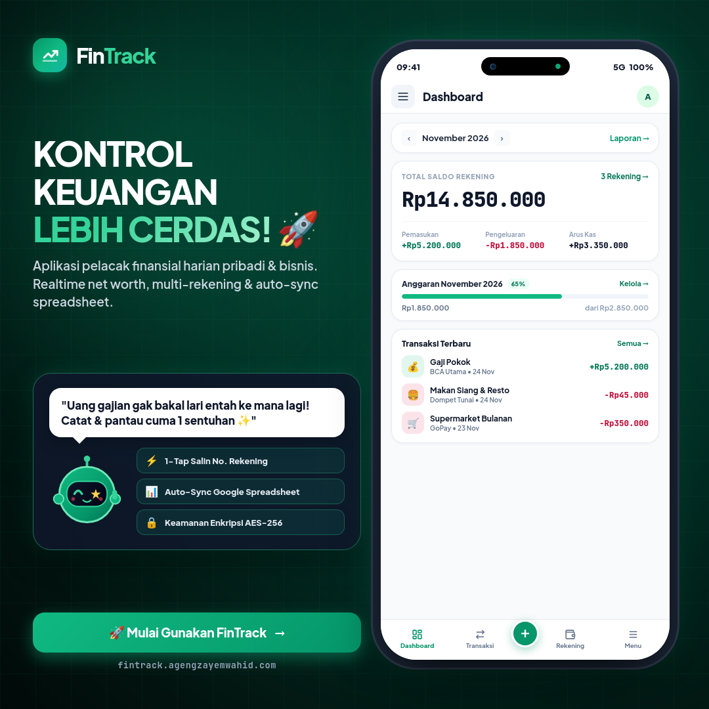

# FinTrack — Smart Financial Tracker

<p align="center">
  
</p>

<p align="center">
  <a href="https://fintrack.nilaismkn1lebong.my.id/"></a>
  
  
  
  
  
  
</p>

---

## 🌐 Live Application & PWA

Aplikasi FinTrack telah resmi di-*deploy* ke server produksi dan siap digunakan secara gratis:

👉 **[Buka FinTrack Live Demo](https://fintrack.nilaismkn1lebong.my.id/)**

> 📱 **Dukungan PWA (Progressive Web App):**  
> FinTrack dapat di-install langsung ke layar utama smartphone Anda (Android / iOS) maupun Desktop tanpa perlu mengunduh file besar dari Google Play Store atau Apple App Store. Cukup buka tautan di atas lewat browser HP (Chrome/Safari), lalu pilih menu **"Tambahkan ke Layar Utama" / "Add to Home Screen"**. Aplikasi akan langsung terpasang mandiri, hemat memori, dan terasa seperti aplikasi native!

---

## 📖 Tentang FinTrack

**FinTrack** adalah aplikasi pelacak keuangan harian modern yang dirancang untuk mengatasi masalah klasik pencatatan finansial: spreadsheet yang kekecilan di layar HP, atau aplikasi pencatat keuangan yang rumit dan penuh iklan. 

FinTrack mengutamakan **kecepatan pencatatan, tampilan bersih (anti-AI slop), keamanan tingkat perbankan, dan kemudahan akses data mandiri**.

---

## ✨ Fitur-Fitur Utama

### 1. 📱 Dasbor Finansial & Cashflow Realtime
* **Perhitungan Kekayaan Bersih (Net Worth)**: Akumulasi saldo otomatis dari seluruh akun rekening aktif.
* **Arus Kas 3 Kolom**: Membandingkan total pemasukan, pengeluaran, dan selisih bersih (*surplus/defisit*) bulan berjalan dalam satu tampilan ringkas.
* **Tren Visual & Proporsi**: Dilengkapi grafik tren bulanan dan persentase pengeluaran per kategori menggunakan Chart.js.

### 2. ⚡ 1-Tap Salin Nomor Rekening
* Seluruh rekening bank (BCA, Mandiri, BNI, dll.) dan dompet digital (GoPay, OVO, Dana) tersusun rapi layaknya kartu dompet digital.
* Dilengkapi tombol salin nomor rekening instan **1 kali sentuh** ke clipboard — sangat praktis saat perlu membagikan nomor rekening ke rekan bisnis atau teman.

### 3. 📊 Sinkronisasi Otomatis Google Spreadsheet
* Setiap transaksi yang Anda catat otomatis disinkronkan 2 arah ke Google Spreadsheet pribadi Anda.
* Menggunakan antrean latar belakang (*background queue worker*) yang toleran terhadap kegagalan jaringan (otomatis *retry* 3x dengan *exponential backoff*).
* Anda memegang kendali 100% atas data Anda sendiri di Google Drive pribadi.

### 4. 📅 Histori Harian & Modal Edit Kilat
* Transaksi dikelompokkan rapi per tanggal (*Daily Divider*), bukan tabel kaku.
* Menyentuh baris transaksi mana pun langsung membuka *bottom-sheet modal* untuk mengubah nominal, rekening, atau kategori dalam hitungan detik.

### 5. 🎯 Pemantauan Anggaran Bulanan
* Pasang plafon anggaran pengeluaran per kategori.
* Indikator progres visual dinamis: bar hijau untuk aman, kuning mendekati batas, dan merah jika melewati batas anggaran.

### 6. 🔒 Keamanan & Isolasi Multi-User Penuh
* **UUID di Semua Entitas**: Seluruh ID transaksi, rekening, dan kategori menggunakan UUID acak sehingga mustahil ditebak oleh pihak luar.
* **Enkripsi Kredensial AES-256**: Kredensial integrasi Google Service Account tersimpan di database dengan enkripsi kuat (`encrypted:array`).
* **Proteksi Akses Berlapis**: Validasi kepemilikan data di setiap rute controller memastikan tidak ada pengguna yang bisa melihat data pengguna lain.

### 7. 🔑 Akses 1-Klik Google OAuth
* Pengguna baru bisa langsung masuk dan menggunakan aplikasi dalam 1 kali klik menggunakan akun Google tanpa perlu formulir registrasi yang panjang.
* Pengguna baru otomatis mendapatkan rekening awal dan 14 kategori keuangan siap pakai (*auto-onboarding*).

---

## 🛠️ Tech Stack & Arsitektur

| Lapisan | Teknologi | Deskripsi |
| :--- | :--- | :--- |
| **Backend** | **Laravel 11 (PHP 8.3)** | Arsitektur MVC modern, Form Requests, Queue Jobs, Eloquent ORM |
| **Frontend** | **Vue 3 (Composition API)** | Reactive SPA menggunakan `<script setup>` dan TypeScript types |
| **Glue Layer** | **Inertia.js v2** | Menghubungkan Laravel backend dengan Vue SPA tanpa REST API kaku |
| **Styling** | **Tailwind CSS v3** | Desain responsif mobile-first, dark accents, dan utility-first styling |
| **Icons & Charts**| **Lucide Icons & Chart.js** | Visualisasi data interaktif & ikon antarmuka modern |
| **Database** | **PostgreSQL / MySQL** | Kompatibel penuh untuk database lokal maupun shared hosting |
| **Testing** | **Pest PHP** | **99 automated tests passed** (353 assertions) menjamin keandalan fitur |

---

## 💻 Panduan Instalasi Lokal

Jika Anda ingin menjalankan FinTrack di komputer lokal untuk pengembangan:

### 1. Clone Repository
```bash
git clone https://github.com/agengwahid/gengs-fintrack.git
cd gengs-fintrack
```

### 2. Install Dependensi PHP & JavaScript
```bash
composer install
npm install
```

### 3. Konfigurasi Lingkungan (`.env`)
```bash
cp .env.example .env
php artisan key:generate
```

Sesuaikan konfigurasi database Anda di `.env`:
```env
DB_CONNECTION=pgsql
DB_HOST=127.0.0.1
DB_PORT=5432
DB_DATABASE=gengs_fintrack
DB_USERNAME=postgres
DB_PASSWORD=secret
```

### 4. Jalankan Migrasi & Seeder
```bash
php artisan migrate --seed
```

### 5. Jalankan Pengujian Otomatis
```bash
./vendor/bin/pest
```

### 6. Jalankan Server Pengembangan
Buka dua jendela terminal terpisah:
```bash
# Terminal 1: Vite HMR
npm run dev

# Terminal 2: Server Laravel
php artisan serve
```
Akses aplikasi melalui peramban di: **`http://localhost:8000`**

---

## 📄 Lisensi

FinTrack dilisensikan di bawah lisensi terbuka [MIT License](LICENSE).  
Dibuat dengan ❤️ oleh [Muhammad Ageng Zayem Wahid](https://github.com/agengwahid).
